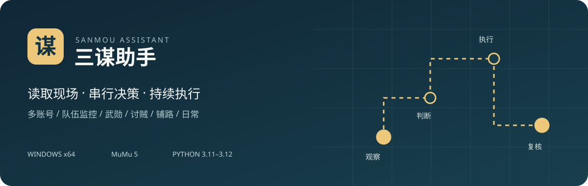

<p align="center"></p>

<p align="center">
<a href="https://github.com/study-college/sanmou-assistant/releases/latest"></a>
<a href="https://github.com/study-college/sanmou-assistant/actions/workflows/ci.yml"></a>
<a href="LICENSE"></a>

</p>

<p align="center"><a href="https://github.com/study-college/sanmou-assistant/releases/latest">下载 Windows 完整包</a> · <a href="docs/09-user-guide.md">使用指南</a> · <a href="CHANGELOG.md">更新记录</a> · <a href="https://github.com/study-college/sanmou-assistant/issues/new/choose">问题反馈</a> · <a href="CONTRIBUTING.md">参与贡献</a></p>

# 三谋助手

《三国：谋定天下》的 Windows 桌面助手，通过截图识别和 Android 模拟输入读取现场、监控队伍并按配置安排任务。支持单窗口多账号，配置和运行记录保存在使用者本机。

当前源码版本 **0.9.2**（未打包、未发布）；公开最新发行仍为 **0.9.0**。本项目为独立社区项目，与游戏及模拟器厂商没有官方隶属关系；识别与模拟输入可能出错，不保证游戏账号安全。

## 能做什么

| 模块 | 当前能力 |
|---|---|
| 多账号 | 每个账号独立配置、Worker、会话与数据库；同一模拟器实例只允许一个控制者 |
| 武勋与监控 | 按真实队伍状态和配置指令顺序调度，单队失败隔离，持续巡检 |
| 讨贼 | 使用游戏实际奖励余数，额外无奖励协助有独立开关，默认关闭 |
| 自动铺路 | 多阶段路线、队伍状态复核与进度保存 |
| 粮食与日常 | 城内寻找农田、低粮恢复，以及分别开启的签到、月卡与免费奖励等任务 |
| 诊断 | 实时日志、预览、本地诊断导出和截图滚动保存 |

## 立即开始

1. 打开 [最新正式版](https://github.com/study-college/sanmou-assistant/releases/latest)，下载名称带 **Windows-x64-full.zip** 的完整包；`source.zip` 和 GitHub 自动生成的 Source code 供开发使用。
2. **完整解压**到本人可写目录，双击根目录 `启动助手.cmd`。程序版自带 Python、Qt 和 OCR 依赖，不必另外安装 Python。
3. 在自己的 MuMu 中登录游戏；在助手中发现实例、匹配渠道，并校验本人的账号与主城。
4. 保存队伍、目标和任务开关，先运行 **只监控**，确认读数正确后再 **开始执行**。
5. 退出或停止只停止新输入，不撤军、不取消游戏内任务，也不关闭模拟器。

ZIP 附有同名 `.sha256` 文件；解压后还可运行 `校验完整性.ps1`，逐项检查原始发布文件。升级前停止助手并备份自己的 `data/`，不要用空白数据覆盖已有配置。

详细设置、连接故障与操作边界见 [使用指南](docs/09-user-guide.md)；需要帮助见 [SUPPORT.md](SUPPORT.md)。

## 环境与验证范围

| 项目 | 要求或已验证基线 |
|---|---|
| 系统 | Windows 10/11 x64 |
| 模拟器 | Windows MuMu 5，实测基线 5.30.1.3586 |
| 游戏画面 | 简体中文，推荐 1920×1080 横屏；其他布局需独立验证 |
| 源码环境 | 标准 CPython 3.11–3.12 x64，不使用 Anaconda/Conda |

0.9.2 把队伍读取与页码解耦：删除“用固定屏幕区域近白像素猜第 2 页”的入口判据，3 队地图上的浅色地基不再导致三队全灭；队伍入口只点头像，进入部队页后按游戏自己的“部队一/二/…”行和选中高亮核对身份。全量测试 520 passed / 57 skipped；2026-11-09 两次实机 scan（只监控）均读到 3 队且无 WARN/ERROR。详见 [CHANGELOG](CHANGELOG.md)。

0.9.1 是赛季初队伍不满的启动兼容：每次启动先重新核实主城坐标，再从游戏“部队总览”左侧的“部队一/二/…”读实际队伍，有几队用几队，不再要求五队、分页条、亲卫队或八支队伍；屯田补粮只跟随刷武勋，没有刷武勋队时不屯田，其他工作照常。2026-11-08 实机又纠正了出征卡槽按实际队伍数整体居中，并适配新赛季无“亲卫整编”的主城布局；第二队对空地(18,204)实机行军一次通过，第一队未被触碰。全量测试 537 passed / 58 skipped；详见 [CHANGELOG](CHANGELOG.md)。

0.9.0 是界面与交互改版：窗口按屏幕可用区域自适应，运行总览分区可拖拽，每支队伍只选一个任务且可整体隐藏；游戏调度逻辑沿用 0.8.1。源码最低要求 Python 3.11。独立测试、源码 OCR、Windows 构建、完整包下载与打包 exe 的 OCR 检查由 GitHub Actions 验证，记录可在 [Actions](https://github.com/study-college/sanmou-assistant/actions) 查看。

已有实机记录覆盖部分指令受理、重伤恢复后继续出发和短时巡检。**铺路实战中的补给下降、遇敌路线重选与击退恢复尚未实现**；其他机器、账号、赛季布局和长期无人值守仍需分别验证。见 [路线图与限制](docs/ROADMAP.md)。

## 从源码运行

在仓库根目录打开 PowerShell：

```powershell
powershell -NoProfile -ExecutionPolicy Bypass -File .\scripts\setup-source.ps1
powershell -NoProfile -ExecutionPolicy Bypass -File .\scripts\start-source.ps1
```

安装器创建隔离的 `.venv` 并安装锁定依赖，首次安装需要网络。安装后可直接运行与检查：

```powershell
.\.venv\Scripts\python.exe -m sanmou_assistant --data-dir .\data
.\.venv\Scripts\python.exe -m pytest -q
.\.venv\Scripts\python.exe scripts/audit_publication.py --repository . --history
```

`tests/` 是可独立运行的脱敏测试；`research-tests/` 保留历史图片回归代码，其私有样本没有发布，不属于默认测试集。测试成功不等于所有游戏页面和长期执行已验证。

## 结构与构建

```text
sanmou_assistant/       界面、识别、调度与识别资源
tests/                 独立测试
research-tests/        需要私有样本的历史测试代码
docs/                  使用说明、版本记录和路线图
scripts/               源码环境、构建、打包和发布审计
.github/               CI、手动发行、问题与 PR 模板
```

本机构建：

```powershell
powershell -NoProfile -ExecutionPolicy Bypass -File .\scripts\build.ps1 -Python .\.venv\Scripts\python.exe
.\.venv\Scripts\python.exe .\scripts\package_release.py
```

维护者也可手动运行 **Build Windows release**，按已有标签构建并上传 Release；再运行 **Verify Windows release**，完整下载、核对清单并检查打包 exe 的 OCR。两套发行流程不按时间自动运行。提交和 PR 的常规检查使用只读权限，不接管模拟器或游戏。

## 贡献、隐私与许可

欢迎提供可复现的脱敏反馈、代码与文档改进。先读 [贡献说明](CONTRIBUTING.md) 和 [社区行为准则](CODE_OF_CONDUCT.md)。安全漏洞通过 [私密报告](SECURITY.md) 处理。

仓库和发行包不携带维护者的账号配置、完整游戏截图、数据库、日志或登录凭据；这些运行数据应留在使用者自己的 `data/`。诊断包可能含昵称、坐标、画面和机器路径，分享前请检查。

原创代码与文档使用 [MIT License](LICENSE)。第三方依赖、模型、游戏图形与商标保留各自权利；识别用裁切图不属于 MIT 授权，详见 [第三方说明](THIRD_PARTY_NOTICES.md)。项目不包含游戏或模拟器安装程序。
